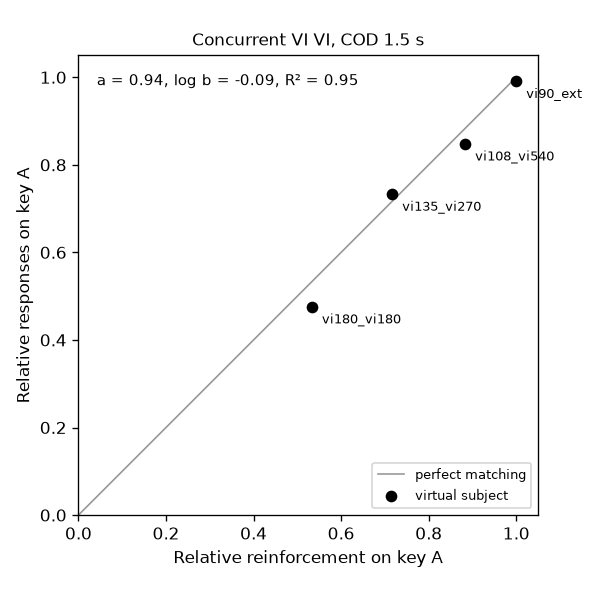

# 並立 VI VI のマッチング

:gb: [English](README.md)

Herrnstein（1961）が報告したマッチングの関係を再現する。切り替え遅延（COD）付きの並立変間隔（VI）スケジュールでは、あるキーへの相対反応頻度が、そのキーでの相対強化頻度にほぼ等しくなる。

## 実行

```bash
pip install operantkit
python examples/concurrent_vi_matching/run.py
```

スクリプトは Herrnstein の 4 組のスケジュールを、いずれも COD 1.5 秒で走らせ、`run.py` と同じフォルダに次を書く。

- `concurrent_vi_matching_<condition>.okl` — 各条件の最後のセッションの OKL v1 イベントログ
- `concurrent_vi_matching.png` — キー A の相対強化に対するキー A の相対反応（対角線 = 完全なマッチング付き）

あわせて、条件ごとの度数・割合と、一般化マッチング法則の当てはめを表示する。`python examples/concurrent_vi_matching/run.py --no-cod` は同じ条件を COD 無しで走らせ、`no_cod/` に書く。

この例には、PyPI の最初の公開版より新しい 2 つが要る。

- 強化子を保持する COD を持つ contingency-py（COD 中に設定された強化子をそのキーに残し、COD 明けの最初の反応で提示する）。COD 中の強化子を捨てる contingency-py では、被験体が一方のキーだけを選ぶ状態に崩れ、当てはめが失敗する。インストール済みの版が捨てる場合は <https://github.com/OperantKit/contingency-py> から contingency-py を入れる。
- experiment-io の `MatchingSubject`。インストール済みの experiment-io にこれが無い場合は <https://github.com/OperantKit/experiment-io> から experiment-io を入れる。

## 何が動いているか

各条件は次のような contingency-dsl の文字列である。

```
@algorithm("fleshler-hoffman", n=12, seed=1975)
Conc(VI 135-s, VI 270-s, COD=1.5-s)
```

これを contingency-dsl が解析し、contingency-py の `Concurrent` スケジュールに変換し、session-runner が走らせる。experiment-io の `drive()` が仮想被験体の反応をセッションに渡し、全イベントを session-recorder 経由で OKL ログに書く。セッションは強化 60 回で終わり、強化子は 1 回 4 秒である。

| 条件 | キー A | キー B |
|---|---|---|
| `vi180_vi180` | VI 180 秒 | VI 180 秒 |
| `vi135_vi270` | VI 135 秒 | VI 270 秒 |
| `vi108_vi540` | VI 108 秒 | VI 540 秒 |
| `vi90_ext` | VI 90 秒 | EXT |

どの組も合計で 1 時間あたり 40 強化になる。各条件は 1 体の被験体で 5 セッション走らせ（条件ごとに新しい被験体）、セッションごとに Fleshler-Hoffman の系列を引き直す。解析するのは最後のセッションだけである。

被験体は experiment-io の `MatchingSubject`（`stay=0.9`、他の値は既定）。1 Hz で反応し、キーごとに「そのキーへの反応あたりの強化子」の移動平均を持ち、平均が高いキーへ反応の配分を寄せる（melioration）。マッチングは被験体に書き込まれていない。配分は両キーの反応あたり強化子が等しい点で止まり、その点に達するかどうかはスケジュールで決まる。

## 結果（seed 1961）



| 条件 | 反応 A / B | 強化子 A / B | キー A の相対反応 | キー A の相対強化 |
|---|---|---|---|---|
| `vi180_vi180` | 3190 / 3513 | 32 / 28 | 0.476 | 0.533 |
| `vi135_vi270` | 4534 / 1650 | 43 / 17 | 0.733 | 0.717 |
| `vi108_vi540` | 4871 / 873 | 53 / 7 | 0.848 | 0.883 |
| `vi90_ext` | 5146 / 48 | 60 / 0 | 0.991 | 1.000 |

相対反応と相対強化の差は最大 0.057。両キーとも強化される 3 条件に一般化マッチング法則 log(B_A / B_B) = a · log(R_A / R_B) + log b を当てはめると（session-analyzer の `estimate_matching_parameters`）、a = 0.94、log b = −0.09、R² = 0.95。

`tests/test_examples.py` は、a が 0.8〜1.2 で R² が 0.9 超であること、どの条件も差が 0.10 以下であること、seed を固定すると OKL ログがバイト単位で一致することを検査する。

他の seed（1、2、3、7、42、100）では、差の最大は 0.055 以下に収まったが、a は 0.68〜1.23 に散らばった。当てはめは、各 1 セッション（強化 60 回）から得た 3 点で行うため、これらの指標の中で a が最も不安定である。

### 再現していないこと: COD を外したときの効果

Herrnstein は、COD 無しでキー A の強化が約 66% のとき、2 羽のハトのキー A への反応が 50% と 56% で、COD 有りのときの範囲を外れたと報告している。この例ではこのずれは再現しない。`--no-cod`（seed 1961）では差の最大が 0.052、a = 0.91 である。Herrnstein はこの効果を、切り替え後の最初のつつきで餌が出ることで強化される第 3 のオペラント（切り替え）によるものとしている。`MatchingSubject` には強化によって率が変わる切り替え反応が無いため、ここでは COD を外してもほとんど変わらない。

## 原典の手続きとの違い

- Herrnstein は各条件を 17〜44 セッション、同じハトで通して走らせ、最後の 5 セッションを合算した。この例は各条件 5 セッション、条件ごとに新しい被験体で、最後の 1 セッションだけを解析する。
- 被験体はハトではなく 1 Hz で反応する模擬被験体で、絶対反応率は比べられない。

## 出典

Herrnstein の Method: "Each time a peck to one key followed a peck to the other key, no reinforcement was possible for 1.5 seconds. … At least two consecutive pecks on a given key were necessary before reinforcement was possible."（一方のキーへのつつきの後に他方のキーをつつくたびに、1.5 秒間は強化が起こりえない。強化が起こりうるには、同じキーへの少なくとも 2 回連続のつつきが要る。）値の組は VI 3 分 VI 3 分、VI 2.25 分 VI 4.5 分、VI 1.8 分 VI 9 分、VI 1.5 分と他方のキーは消去。強化子は穀物への 4 秒間のアクセス、セッションは強化 60 回。相対反応頻度は相対強化頻度に "with a maximum discrepancy of only about 8%"（最大でも約 8% の食い違い）で一致した。

- Herrnstein, R. J. (1961). Relative and absolute strength of response as a function of frequency of reinforcement. *Journal of the Experimental Analysis of Behavior, 4*(3), 267–272. https://doi.org/10.1901/jeab.1961.4-267
