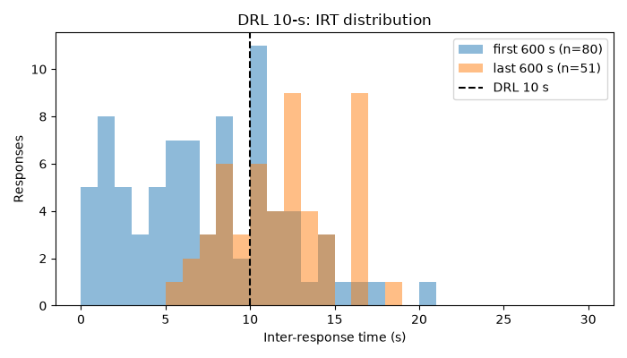
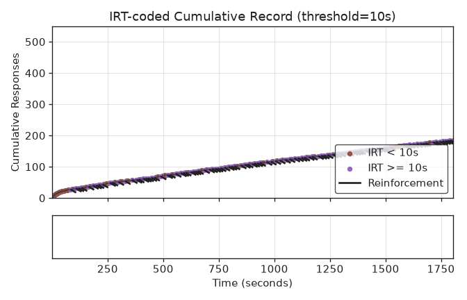

# DRL inter-response times

:jp: [日本語版](README.ja.md)

Reproduces the direction of the effect of differential reinforcement of low rate (DRL) described by Ferster and Skinner (1957): when a response is reinforced only if enough time has passed since the previous response, the inter-response times (IRTs) lengthen and the overall response rate falls.

## Run

```bash
pip install operantkit
python examples/drl_irt/run.py
```

The script runs `DRL 10-s` for 1800 s of session time (0.5-s reinforcer) and writes, next to `run.py`:

- `drl_irt.okl` — the OKL v1 event log
- `drl_irt_histogram.png` — IRT histograms of the first and last 600 s, with the 10-s interval marked
- `drl_irt_cumulative.png` — the IRT-coded cumulative record (`session-analyzer diff-plot drl_irt.okl --threshold 10 --output drl_irt_cumulative.png` draws the same figure)

`python examples/drl_irt/run.py --subject poisson` runs the memoryless 1 Hz control instead.

The subject is `SpacedRespondingSubject` from experiment-io. If the installed experiment-io does not provide it, install experiment-io from <https://github.com/OperantKit/experiment-io>.

## What runs

The DSL string is parsed by contingency-dsl, turned into the contingency-py `DRL` schedule, and run by session-runner. contingency-py's `DRL` reinforces a response when at least 10 s have passed since the previous response (the first response of the session is also reinforced). experiment-io's `drive()` feeds the virtual subject's responses into the session and writes every event to the OKL log through session-recorder. Nothing in the pipeline is specific to this example; only the subject is.

`SpacedRespondingSubject` draws each IRT from a normal distribution with mean `mu` and coefficient of variation 0.3 (redrawn until positive), starting from `mu = 1 s`. After a response that is not reinforced, `mu` moves toward twice that response's IRT (`mu += 0.1 * (2 * irt - mu)`); after a reinforced response, `mu` shrinks by 2% (`mu *= 0.98`). The subject knows nothing about the schedule: it only receives the reinforcers the schedule delivers.

## Result (seed 1953)





| Subject | Responses | Reinforcers | IRTs >= 10 s, first 600 s | IRTs >= 10 s, last 600 s | Rate, first 600 s | Rate, last 600 s |
|---|---|---|---|---|---|---|
| `SpacedRespondingSubject` | 186 | 98 | 0.34 | 0.71 | 0.133 /s | 0.085 /s |
| Poisson control (1 Hz) | 1796 | 2 | 0.002 | 0.000 | 1.028 /s | 0.973 /s |

Each IRT is counted in the window of the response that ends it. Over seeds 1950 to 1959, the share of IRTs at or above 10 s in the last 600 s ranged from 0.58 to 0.72 and was always larger than in the first 600 s, and the rate always fell. `tests/test_examples.py` checks that the last-600-s share is at least 0.5 and larger than the first-600-s share, that the rate falls, that the control's share is below 0.05, and that a fixed seed reproduces the OKL log byte for byte.

The subject's update moves `mu` toward twice the unreinforced IRT. With a factor of 1.2, `mu` levels off below 10 s and fewer than a third of the IRTs in the last 600 s reach the interval (0.17 to 0.29 over seeds 1950 to 1959), because only IRTs shorter than the interval go unreinforced.

## Source

Ferster and Skinner define drl as reinforcing a response only when a set time has elapsed since the previous response, and report that adding drl 6 s to VI 1 min lowered the overall rate from about 1.1 to about 0.35 responses per second. The two studies below examined the spacing of responses and the IRT distribution under this contingency; this example cites them for context only and quotes no numbers from them.

- Ferster, C. B., & Skinner, B. F. (1957). *Schedules of reinforcement*. Appleton-Century-Crofts. https://doi.org/10.1037/10627-000
- Wilson, M. P., & Keller, F. S. (1953). On the selective reinforcement of spaced responses. *Journal of Comparative and Physiological Psychology*, *46*(3), 190–193. https://doi.org/10.1037/h0057705
- Kelleher, R. T., Fry, W., & Cook, L. (1959). Inter-response time distribution as a function of differential reinforcement of temporally spaced responses. *Journal of the Experimental Analysis of Behavior*, *2*(2), 91–106. https://doi.org/10.1901/jeab.1959.2-91
