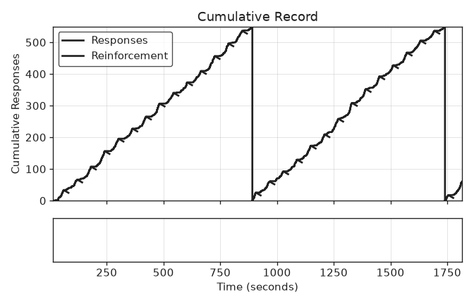

# FI scallop

:jp: [日本語版](README.ja.md)

Reproduces the fixed-interval (FI) pattern described by Ferster and Skinner (1957): after each reinforcer the subject pauses, then responds at an accelerating rate until the next reinforcer. On a cumulative record this gives the "scallop".

## Run

```bash
pip install operantkit
python examples/fi_scallop/run.py
```

The script runs `FI 60-s` for 30 reinforcers (0.5-s reinforcer) and writes, next to `run.py`:

- `fi_scallop.okl` — the OKL v1 event log
- `fi_scallop.png` — the cumulative record (`session-analyzer plot fi_scallop.okl --output fi_scallop.png` draws the same figure)

`python examples/fi_scallop/run.py --subject poisson` runs the memoryless control instead.

The subject is `ScallopSubject` from experiment-io. If the installed experiment-io does not provide it, install experiment-io from <https://github.com/OperantKit/experiment-io>.

## What runs

The DSL string is parsed by contingency-dsl, turned into the contingency-py `FI` schedule, and run by session-runner. experiment-io's `drive()` feeds the virtual subject's responses into the session and writes every event to the OKL log through session-recorder. Nothing in the pipeline is specific to this example; only the subject is.

`ScallopSubject` responds with hazard `2 Hz * min(1, (t / 60 s)^2)`, where `t` is the time since the last reinforcer. A reinforcer resets `t` to 0. The subject knows nothing about the schedule: it only receives the reinforcers the schedule delivers.

## Result (seed 1957)



| Subject | Responses | Intervals with more responses in the second half | Median quarter-life |
|---|---|---|---|
| `ScallopSubject` | 1161 | 30 of 30 | 0.63 |
| Poisson control (1 Hz) | 1771 | 12 of 30 | 0.25 |

The quarter-life (session-analyzer's `compute_quarter_life`) is the fraction of the interval that has elapsed when a quarter of the interval's responses have been emitted. A constant response rate gives about 0.25; responding concentrated late in the interval gives larger values. `tests/test_examples.py` checks these measures (at least 25 of 30 accelerating intervals and a median quarter-life above 0.5 for `ScallopSubject`; 0.20 to 0.30 for the control) and that a fixed seed reproduces the OKL log byte for byte.

## Source

Ferster and Skinner describe FI performance as a pause after reinforcement followed by a smooth acceleration to a terminal rate that is held until the next reinforcer (FI 1 min).

- Ferster, C. B., & Skinner, B. F. (1957). *Schedules of reinforcement*. Appleton-Century-Crofts. https://doi.org/10.1037/10627-000
