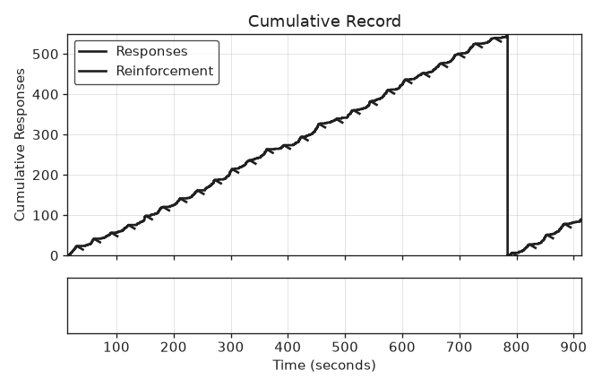

# 論文の手続き

:gb: [English](README.md)

公刊された実験の手続きを DOI から走らせる。スクリプトは `papers.json` で DOI を引き、論文の Method 節から取り出した contingency-dsl の文字列を仮想被験体で走らせ、累積記録を描き、論文が報告している定性的なパターンが出たかを判定する。比べるのは定性的なパターンだけで、論文の数値とは比べない。

## 実行

```bash
# PyPI に公開されるまでは、OperantKit の依存と一緒に GitHub から入れる。
pip install git+https://github.com/OperantKit/contingency-dsl-py \
            git+https://github.com/OperantKit/contingency-py \
            git+https://github.com/OperantKit/experiment-core \
            git+https://github.com/OperantKit/session-recorder \
            git+https://github.com/OperantKit/session-runner \
            git+https://github.com/OperantKit/session-analyzer \
            git+https://github.com/OperantKit/experiment-io \
            git+https://github.com/OperantKit/operantkit-cli \
            git+https://github.com/OperantKit/operantkit-py
python examples/paper_procedure/run.py --doi 10.1016/j.beproc.2004.08.007
```

スクリプトは `run.py` と同じフォルダに次を書く。

- `<slug>.okl` — OKL v1 のイベントログ
- `<slug>.png` — 累積記録

そして JSON の報告を出す: DSL、比べる図、期待パターン、指標、一致したか（`judgement.matched`）。

| オプション | 意味 |
|---|---|
| `--control` | カタログの対照被験体で走らせる（指定が無ければ一定率 1 Hz のポアソン被験体）。判定は不一致になるはず |
| `--dsl-dir DIR` | `papers.json` の代わりに、DOI を名前にした生成 DSL ファイル（`/` を `_` に置き換え、拡張子 `.dsl`）のフォルダから DSL を読む |
| `--block N` または `--block <スケジュール>` | 複数ブロックの DSL ファイルから 1 つを選ぶ。1 始まりの番号か、ブロックのスケジュール行（例: `FR40`） |
| `--out-dir DIR`、`--seed N` | 出力先と被験体の seed |

## カタログ

`papers.json` は DOI ごとに次を持つ: APA 形式の書誌、取り出した DSL、図と期待パターン（言い換え）、仮想被験体とその対照、強化回数、強化子の継続時間、セッション数（判定するのは最後の 1 回）、判定。論文の図は写していない。

| DOI | DSL | 図 | 期待パターン | 被験体 | 判定 |
|---|---|---|---|---|---|
| 10.1016/j.beproc.2004.08.007 | `FI30s` | Fig. 2 | 各区間の初めは反応が少なく、区間が進むにつれて反応率が上がる | `ScallopSubject`（2 Hz・ramp 30 s・指数 2） | `rate_rises_within_interval` |
| 10.1901/jeab.2005.71-04 | `FR5` | Fig. 1 下段 | レバー提示の後に休止が入り、その後は強化子まで速く反応する（break-and-run） | `ScallopSubject`（2 Hz・ramp 3 s・指数 8） | `pause_then_run` |
| 10.1007/bf03394799 | `FR40` | Fig. 2 | 強化後の休止が無い、一定率の反応 | `VirtualSubject`（ポアソン、3 Hz） | `no_postreinforcement_pause` |
| 10.1901/jeab.1968.11-s327 | `VI108s`（seed を固定するため `@algorithm` を付ける） | Fig. 13 | 各区間内でほぼ一定率 | `VirtualSubject`（ポアソン、1 Hz） | `constant_rate_within_interval` |
| 10.1901/jeab.1969.12-887 | `Conc(VI1min, VI3min, COD=2s)` | Fig. 1 | キー A の相対反応率が相対強化率（0.75）に近い | `MatchingSubject`（1 Hz・stay 0.9）、5 セッション | `relative_rate_matches_reinforcement` |

判定 `rate_rises_within_interval` は、1 つの強化子の終了から次の強化子までを 1 区間とする。区間の後半の反応数が前半より多い区間が 80% 以上あり、quarter-life（session-analyzer の `compute_quarter_life`）の中央値が 0.4 以上なら一致とする。一定率なら quarter-life は 0.25 付近になる。

- `pause_then_run`: 強化子の終了から最初の反応までの休止が、ラン内の IRT の中央値の 3 倍以上である区間が 80% 以上。
- `no_postreinforcement_pause`: 休止の中央値がラン内 IRT の中央値の 2 倍以下、上の意味の休止がある区間が 20% 以下、quarter-life の中央値が 0.18〜0.32。
- `constant_rate_within_interval`: 後半の反応が多い区間が 30〜70%、quarter-life の中央値が 0.15〜0.35。
- `relative_rate_matches_reinforcement`: キー A の反応の割合が 0.75 とも、キー A が得た強化の割合とも 0.10 以内。

## 結果（seed 2004）



| 被験体 | 反応数 | 後半の反応が多い区間 | quarter-life の中央値 | 判定 |
|---|---|---|---|---|
| `ScallopSubject` | 640 | 30 区間中 30 | 0.64 | 一致 |
| ポアソン対照（1 Hz） | 904 | 30 区間中 14 | 0.21 | 不一致 |

残り 4 本（seed 2004。`run.py` と同じフォルダの `leslie_2005.png`・`weiner_1982.png`・`catania_reynolds_1968.png`・`stubbs_pliskoff_1969.png`）:

| 論文 | 被験体 | 反応数 | 指標 | 判定 |
|---|---|---|---|---|
| Leslie et al. (2005) | `ScallopSubject` | 150 | 休止のある区間 30 中 30、休止の中央値 3.09 秒、ラン内 IRT の中央値 0.31 秒 | 一致 |
| | ポアソン対照（1 Hz） | 150 | 30 中 4、休止 0.79 秒、IRT 0.68 秒 | 不一致 |
| Weiner (1982) | ポアソン（3 Hz） | 4000 | 休止の中央値 0.24 秒、IRT 0.23 秒、休止のある区間 10%、quarter-life 0.24 | 一致 |
| | `ScallopSubject` 対照（3 Hz・ramp 3 s） | 4000 | 休止 2.83 秒、100%、quarter-life 0.37 | 不一致 |
| Catania & Reynolds (1968) | ポアソン（1 Hz） | 5634 | 後半の反応が多い区間 46%、quarter-life 0.23 | 一致 |
| | `ScallopSubject` 対照（ramp 108 s） | 6053 | 72%、quarter-life 0.55 | 不一致 |
| Stubbs & Pliskoff (1969) | `MatchingSubject`（5 セッションの最後） | 3034 | キー A: 反応の 0.846、強化の 0.867 | 一致 |
| | 独立なポアソン 2 キー（各 0.5 Hz） | 3182 | キー A: 反応の 0.503、強化の 0.75 | 不一致 |

Leslie et al. の記録では 60 秒の試行間間隔が時間軸の大半を占めるので、試行内の break-and-run はセッション全体の縮尺では短すぎて見えない。判定はイベントの時刻から読んでいる。Stubbs & Pliskoff の走行は、予定の 0.75 より実際に得た強化の割合（0.867）に近く、0.75 からは 0.096 で、0.10 の幅をぎりぎりで通っている。原典の Fig. 1 は累積記録ではなく相対率の図で、PNG は 2 キー合計の累積記録。

`tests/test_paper_procedure.py` がコマンドを走らせ、PNG が書かれること、各論文の被験体が一致し対照が一致しないこと、seed を固定すると OKL ログがバイト単位で一致すること、生成 DSL ファイルから DSL のブロックを取り出せることを確かめる。

## 論文の手続きとの違い

各エントリの違いは `papers.json` の `notes` にある。要点:

- Leslie et al. (2005) は 1 分の試行間間隔を挟む離散試行。DSL に試行間間隔が無いので、60 秒の強化子で代用する。
- Weiner (1982): 第 1 から第 8 セッションにかけての率の上昇は比べない（ポアソン被験体はセッション間で変わらない）。
- Catania & Reynolds (1968): contingency-py の VI は定確率（Fleshler-Hoffman）だけなので、Fig. 4 の算術 VI ではなく Fig. 13 と比べる。
- Stubbs & Pliskoff (1969) は Findley 法（主キーと切替キー）。走らせるのは 2 キーで、取り出した DSL に 2 秒の切替遅延を足したもの。

Higa & Simm (2004): 論文では強化子は 20 秒間の鏡像の提示で、次の区間は強化子の終了から測る。contingency-py は定間隔を強化子の開始から測るので、20 秒の強化子では強化子の後に区間が 10 秒しか残らない。そのためカタログでは強化子を 0.5 秒にして、強化子の後の区間を 30 秒近くに保っている。

## 出典

- Catania, A. C., & Reynolds, G. S. (1968). A quantitative analysis of the responding maintained by interval schedules of reinforcement. *Journal of the Experimental Analysis of Behavior*, *11*, 327–383. https://doi.org/10.1901/jeab.1968.11-s327
- Higa, J. J., & Simm, L. A. (2004). Interval timing in Siamese fighting fish (*Betta splendens*). *Behavioural Processes*, *67*, 501–509. https://doi.org/10.1016/j.beproc.2004.08.007
- Leslie, J. C., Shaw, D., Gregg, G., McCormick, N., Reynolds, D. S., & Dawson, G. R. (2005). Effects of reinforcement schedule on facilitation of operant extinction by chlordiazepoxide. *Journal of the Experimental Analysis of Behavior*, *84*, 327–338. https://doi.org/10.1901/jeab.2005.71-04
- Stubbs, D. A., & Pliskoff, S. S. (1969). Concurrent responding with fixed relative rate of reinforcement. *Journal of the Experimental Analysis of Behavior*, *12*, 887–895. https://doi.org/10.1901/jeab.1969.12-887
- Weiner, H. (1982). Histories of response omission and human operant behavior under a fixed-ratio schedule of reinforcement. *The Psychological Record*, *32*, 409–434. https://doi.org/10.1007/bf03394799
