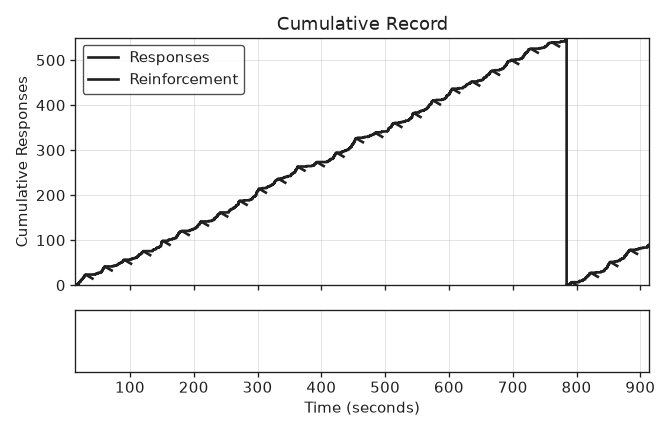

# Paper procedure

:jp: [日本語版](README.ja.md)

Runs the procedure of a published experiment from its DOI. The script looks the DOI up in `papers.json`, takes the contingency-dsl string extracted from the paper's Method section, runs it with a virtual subject, draws the cumulative record, and judges whether the run shows the qualitative pattern the paper reports. Only the qualitative pattern is compared, never the paper's numbers.

## Run

```bash
# Until the PyPI release, install from GitHub together with its OperantKit dependencies.
pip install git+https://github.com/OperantKit/contingency-dsl-py \
            git+https://github.com/OperantKit/contingency-py \
            git+https://github.com/OperantKit/experiment-core \
            git+https://github.com/OperantKit/session-recorder \
            git+https://github.com/OperantKit/session-runner \
            git+https://github.com/OperantKit/session-analyzer \
            git+https://github.com/OperantKit/experiment-io \
            git+https://github.com/OperantKit/operantkit-cli \
            git+https://github.com/OperantKit/operantkit-py
python examples/paper_procedure/run.py --doi 10.1016/j.beproc.2004.08.007
```

The script writes, next to `run.py`:

- `<slug>.okl` — the OKL v1 event log
- `<slug>.png` — the cumulative record

and prints a JSON report: the DSL, the figure it is compared with, the expected pattern, the measures, and whether they match (`judgement.matched`).

| Option | Meaning |
|---|---|
| `--control` | Run the catalog's control subject instead (a constant-rate 1-Hz Poisson subject unless the entry names another); the judge should report a mismatch |
| `--dsl-dir DIR` | Read the DSL from a directory of generated DSL files named after the DOI (`/` replaced by `_`, extension `.dsl`) instead of `papers.json` |
| `--block N` or `--block <schedule>` | Choose one block from a DSL file with several blocks: a 1-based number or the block's schedule line (e.g. `FR40`) |
| `--out-dir DIR`, `--seed N` | Output directory and subject seed |

## Catalog

`papers.json` holds, per DOI: the APA reference, the extracted DSL, the figure and the expected pattern (paraphrased), the virtual subject and its control, the number of reinforcers, the reinforcer duration, the number of sessions (only the last is judged), and the judge. Figures from the papers are not copied.

| DOI | DSL | Figure | Expected pattern | Subject | Judge |
|---|---|---|---|---|---|
| 10.1016/j.beproc.2004.08.007 | `FI30s` | Fig. 2 | Few responses early in each interval; the rate rises as the interval elapses | `ScallopSubject` (2 Hz, ramp 30 s, exponent 2) | `rate_rises_within_interval` |
| 10.1901/jeab.2005.71-04 | `FR5` | Fig. 1, lower panel | A pause after each lever presentation, then fast responding to the reinforcer (break-and-run) | `ScallopSubject` (2 Hz, ramp 3 s, exponent 8) | `pause_then_run` |
| 10.1007/bf03394799 | `FR40` | Fig. 2 | Constant responding without post-reinforcement pauses | `VirtualSubject` (Poisson, 3 Hz) | `no_postreinforcement_pause` |
| 10.1901/jeab.1968.11-s327 | `VI108s` (with `@algorithm` for a fixed seed) | Fig. 13 | A roughly constant rate within each interval | `VirtualSubject` (Poisson, 1 Hz) | `constant_rate_within_interval` |
| 10.1901/jeab.1969.12-887 | `Conc(VI1min, VI3min, COD=2s)` | Fig. 1 | Relative response rate on key A near the relative reinforcement rate (0.75) | `MatchingSubject` (1 Hz, stay 0.9), 5 sessions | `relative_rate_matches_reinforcement` |

The judge `rate_rises_within_interval` takes each interval from the end of one reinforcer to the next reinforcer. It matches when the second half of the interval holds more responses than the first half in at least 80% of intervals and the median quarter-life (session-analyzer's `compute_quarter_life`) is at least 0.4. A constant rate gives a quarter-life near 0.25.

- `pause_then_run`: the pause from the end of a reinforcer to the first response is at least three times the median IRT within the runs, in at least 80% of intervals.
- `no_postreinforcement_pause`: the median pause is at most twice the median run IRT, at most 20% of intervals hold such a break, and the median quarter-life is 0.18 to 0.32.
- `constant_rate_within_interval`: 30% to 70% of intervals hold more responses in their second half, and the median quarter-life is 0.15 to 0.35.
- `relative_rate_matches_reinforcement`: key A's share of responses is within 0.10 of 0.75 and of the obtained share of reinforcers on key A.

## Result (seed 2004)



| Subject | Responses | Intervals with more responses in the second half | Median quarter-life | Judgement |
|---|---|---|---|---|
| `ScallopSubject` | 640 | 30 of 30 | 0.64 | match |
| Poisson control (1 Hz) | 904 | 14 of 30 | 0.21 | mismatch |

The other four papers (seed 2004; `leslie_2005.png`, `weiner_1982.png`, `catania_reynolds_1968.png`, `stubbs_pliskoff_1969.png` next to `run.py`):

| Paper | Subject | Responses | Measures | Judgement |
|---|---|---|---|---|
| Leslie et al. (2005) | `ScallopSubject` | 150 | break in 30 of 30 intervals; median pause 3.09 s, median run IRT 0.31 s | match |
| | Poisson control (1 Hz) | 150 | break in 4 of 30; pause 0.79 s, run IRT 0.68 s | mismatch |
| Weiner (1982) | Poisson (3 Hz) | 4000 | median pause 0.24 s, run IRT 0.23 s; breaks 10%; quarter-life 0.24 | match |
| | `ScallopSubject` control (3 Hz, ramp 3 s) | 4000 | pause 2.83 s; breaks 100%; quarter-life 0.37 | mismatch |
| Catania & Reynolds (1968) | Poisson (1 Hz) | 5634 | second half larger in 46% of intervals; quarter-life 0.23 | match |
| | `ScallopSubject` control (ramp 108 s) | 6053 | 72%; quarter-life 0.55 | mismatch |
| Stubbs & Pliskoff (1969) | `MatchingSubject`, last of 5 sessions | 3034 | key A: 0.846 of responses, 0.867 of reinforcers | match |
| | Two independent Poisson keys (0.5 Hz each) | 3182 | key A: 0.503 of responses, 0.75 of reinforcers | mismatch |

In the Leslie et al. record the 60-s intertrial interval fills most of the time axis, so the break-and-run within a trial is too short to see at the scale of the whole session; the judge reads it from the event times. The Stubbs and Pliskoff run is closer to the obtained share of reinforcers (0.867) than to the programmed 0.75 and only 0.096 from 0.75, so it passes the 0.10 margin narrowly. Their Fig. 1 plots relative rates, not a cumulative record; the PNG is the cumulative record of both keys.

`tests/test_paper_procedure.py` runs the command, checks that the PNG is written, that each paper's subject matches and its control does not, that a fixed seed reproduces the OKL log byte for byte, and that a DSL block is taken from a generated DSL file.

## Differences from the papers' procedures

Each entry's `notes` in `papers.json` lists its differences. In short:

- Leslie et al. (2005) ran discrete trials with a 1-min intertrial interval; the DSL has no intertrial interval, so a 60-s reinforcer stands in for it.
- Weiner (1982): the rise in rate from the first to the eighth session is not compared (a Poisson subject does not change across sessions).
- Catania & Reynolds (1968): contingency-py's VI is constant-probability (Fleshler-Hoffman) only, so the run is compared with Fig. 13, not with the arithmetic VI of Fig. 4.
- Stubbs & Pliskoff (1969) used a Findley procedure (a main key and a changeover key); the run uses two keys with a 2-s changeover delay added to the extracted DSL.

Higa and Simm (2004): In the paper each reinforcer is 20 s of a reflective mirror, and the next interval is timed from the end of the reinforcer. contingency-py times a fixed interval from the onset of the reinforcer, so a 20-s reinforcer would leave only 10 s of the interval after it. The catalog therefore uses a 0.5-s reinforcer, which keeps the interval after each reinforcer close to 30 s.

## Source

- Catania, A. C., & Reynolds, G. S. (1968). A quantitative analysis of the responding maintained by interval schedules of reinforcement. *Journal of the Experimental Analysis of Behavior*, *11*, 327–383. https://doi.org/10.1901/jeab.1968.11-s327
- Higa, J. J., & Simm, L. A. (2004). Interval timing in Siamese fighting fish (*Betta splendens*). *Behavioural Processes*, *67*, 501–509. https://doi.org/10.1016/j.beproc.2004.08.007
- Leslie, J. C., Shaw, D., Gregg, G., McCormick, N., Reynolds, D. S., & Dawson, G. R. (2005). Effects of reinforcement schedule on facilitation of operant extinction by chlordiazepoxide. *Journal of the Experimental Analysis of Behavior*, *84*, 327–338. https://doi.org/10.1901/jeab.2005.71-04
- Stubbs, D. A., & Pliskoff, S. S. (1969). Concurrent responding with fixed relative rate of reinforcement. *Journal of the Experimental Analysis of Behavior*, *12*, 887–895. https://doi.org/10.1901/jeab.1969.12-887
- Weiner, H. (1982). Histories of response omission and human operant behavior under a fixed-ratio schedule of reinforcement. *The Psychological Record*, *32*, 409–434. https://doi.org/10.1007/bf03394799
