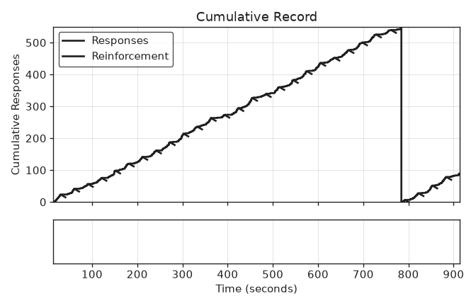

# Paper procedure

:jp: [日本語版](README.ja.md)

Runs the procedure of a published experiment from its DOI. The script looks the DOI up in `papers.json`, takes the contingency-dsl string extracted from the paper's Method section, runs it with a virtual subject, draws the cumulative record, and judges whether the run shows the qualitative pattern the paper reports. Only the qualitative pattern is compared, never the paper's numbers.

## Run

```bash
pip install operantkit
python examples/paper_procedure/run.py --doi 10.1016/j.beproc.2004.08.007
```

The script writes, next to `run.py`:

- `<slug>.okl` — the OKL v1 event log
- `<slug>.png` — the cumulative record

and prints a JSON report: the DSL, the figure it is compared with, the expected pattern, the measures, and whether they match (`judgement.matched`).

| Option | Meaning |
|---|---|
| `--control` | Run a constant-rate (1 Hz) Poisson subject instead; the judge should report a mismatch |
| `--dsl-dir DIR` | Read the DSL from a directory of generated DSL files named after the DOI (`/` replaced by `_`, extension `.dsl`) instead of `papers.json` |
| `--block N` or `--block <schedule>` | Choose one block from a DSL file with several blocks: a 1-based number or the block's schedule line (e.g. `FR40`) |
| `--out-dir DIR`, `--seed N` | Output directory and subject seed |

## Catalog

`papers.json` holds, per DOI: the APA reference, the extracted DSL, the figure and the expected pattern (paraphrased), the virtual subject, the number of reinforcers, the reinforcer duration, and the judge. Figures from the papers are not copied.

| DOI | DSL | Figure | Expected pattern | Subject | Judge |
|---|---|---|---|---|---|
| 10.1016/j.beproc.2004.08.007 | `FI30s` | Fig. 2 | Few responses early in each interval; the rate rises as the interval elapses | `ScallopSubject` (2 Hz, ramp 30 s, exponent 2) | `rate_rises_within_interval` |

The judge `rate_rises_within_interval` takes each interval from the end of one reinforcer to the next reinforcer. It matches when the second half of the interval holds more responses than the first half in at least 80% of intervals and the median quarter-life (session-analyzer's `compute_quarter_life`) is at least 0.4. A constant rate gives a quarter-life near 0.25.

## Result (seed 2004)



| Subject | Responses | Intervals with more responses in the second half | Median quarter-life | Judgement |
|---|---|---|---|---|
| `ScallopSubject` | 640 | 30 of 30 | 0.64 | match |
| Poisson control (1 Hz) | 904 | 14 of 30 | 0.21 | mismatch |

`tests/test_paper_procedure.py` runs the command, checks that the PNG is written, that `ScallopSubject` matches and the control does not, that a fixed seed reproduces the OKL log byte for byte, and that a DSL block is taken from a generated DSL file.

## Difference from the paper's procedure

In the paper each reinforcer is 20 s of a reflective mirror, and the next interval is timed from the end of the reinforcer. contingency-py times a fixed interval from the onset of the reinforcer, so a 20-s reinforcer would leave only 10 s of the interval after it. The catalog therefore uses a 0.5-s reinforcer, which keeps the interval after each reinforcer close to 30 s.

## Source

- Higa, J. J., & Simm, L. A. (2004). Interval timing in Siamese fighting fish (*Betta splendens*). *Behavioural Processes*, *67*, 501–509. https://doi.org/10.1016/j.beproc.2004.08.007
